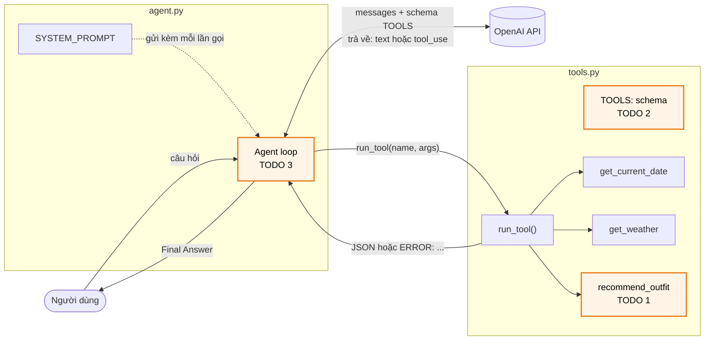
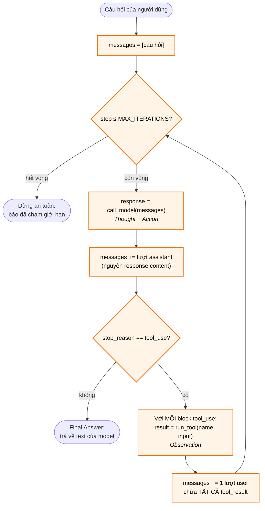
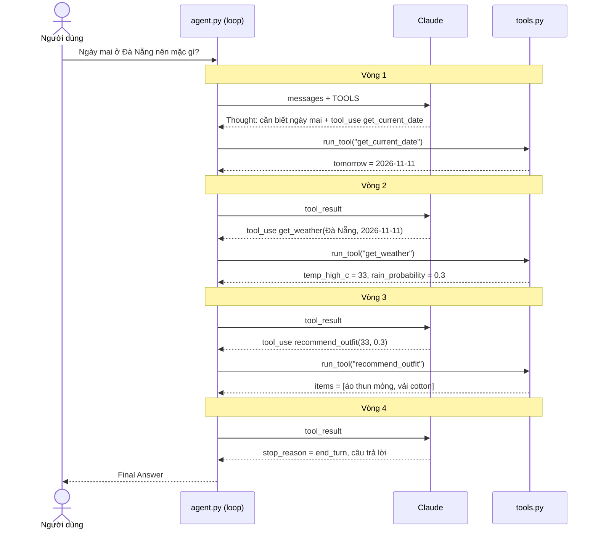
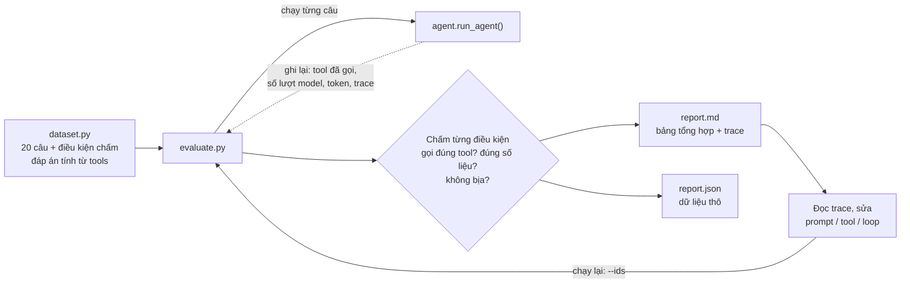

# Bài tập Ngày 4: Tự viết một ReAct agent từ đầu

Bạn sẽ tự tay làm 2 phần cốt lõi của một agent, không dùng framework:

1. **Tool:** "tay chân" để agent làm việc thật.
2. **Agent loop:** vòng lặp Thought → Action → Observation.

Sau đó chấm agent của mình trên bộ 20 câu hỏi, từ dễ đến khó, và đọc report để tìm chỗ agent sai.

Agent trong bài là trợ lý du lịch: hỏi *"Ngày mai ở Đà Nẵng nên mặc gì?"*, agent tự tra ngày, tra thời tiết, rồi gợi ý trang phục.

## Ý tưởng

Một agent không có gì bí ẩn. Nó chỉ gồm 3 thứ:

```
Agent = LLM (bộ não) + Tools (tay chân) + Loop (vòng lặp nối hai thứ đó lại)
```

- **LLM** quyết định bước tiếp theo: trả lời luôn, hay cần gọi tool nào, với tham số gì.
- **Tool** là code Python bình thường, làm việc thật (tra ngày, tra thời tiết...). LLM không tự chạy được tool, nó chỉ *yêu cầu* gọi.
- **Loop** là phần code của bạn: nhận yêu cầu từ LLM → chạy tool → gửi kết quả lại → hỏi LLM tiếp, cho tới khi LLM trả lời xong.

Framework như LangChain hay LangGraph làm hộ phần **Loop**. Bài này bắt bạn tự viết nó, để hiểu framework đang làm gì bên dưới.

### Kiến trúc tổng thể

Ô viền cam là phần bạn tự viết (TODO).



- **Schema** (TODO 2) là thứ duy nhất LLM nhìn thấy về tool. Thiếu schema, LLM không biết tool tồn tại dù hàm đã viết xong.
- **`run_tool()`** luôn trả về chuỗi. Khi tool lỗi, nó trả `ERROR: ...` thay vì làm sập chương trình, để LLM đọc lỗi và tự sửa tham số.

## Repo có gì

| File | Nội dung |
|---|---|
| `tools.py` | 2 tool mẫu đã viết sẵn (`get_current_date`, `get_weather`) và **TODO 1, TODO 2** |
| `agent.py` | System prompt, hàm gọi model và **TODO 3** |
| `check.py` | Tự kiểm tra 3 TODO, không cần API key |
| `dataset.py` | 20 câu hỏi test, chia 4 mức: easy, medium, hard, edge |
| `evaluate.py` | Chạy agent trên dataset, chấm tự động, xuất `report.md` và `report.json` |
| `run.sh` | Chạy mọi thứ bằng 1 lệnh (Mac, Linux) |

## Bắt đầu

Yêu cầu Python 3.10 trở lên.

```bash
git clone https://github.com/VinUni-AI20k/K5-L3-Day04-ChatbotVsAgent.git
cd K5-L3-Day04-ChatbotVsAgent
./run.sh setup
```

`setup` tạo môi trường `.venv`, cài thư viện và tạo file `.env`. Mở `.env` và điền `OPENAI_API_KEY` của bạn.

Các lệnh dùng trong bài:

| Lệnh | Làm gì | Cần API key? |
|---|---|---|
| `./run.sh check` | Kiểm tra 3 TODO | Không |
| `./run.sh ask "Ngày mai ở Đà Nẵng nên mặc gì?"` | Hỏi agent 1 câu, xem trace | Có |
| `./run.sh eval` | Chấm agent trên cả 20 câu, xuất report | Có |
| `./run.sh eval --level edge` | Chỉ chạy 1 mức: `easy`, `medium`, `hard`, `edge` | Có |
| `./run.sh eval --ids E2,M3` | Chỉ chạy vài câu (tiết kiệm token khi đang sửa lỗi) | Có |

**Windows, hoặc không muốn dùng script:** cài thủ công rồi gọi thẳng Python.

```bash
python -m venv .venv
.venv\Scripts\activate          # Mac / Linux: source .venv/bin/activate
pip install -r requirements.txt
copy .env.example .env           # Mac / Linux: cp .env.example .env, rồi điền OPENAI_API_KEY

python check.py                  # = ./run.sh check
python agent.py "Ngày mai ở Đà Nẵng nên mặc gì?"   # = ./run.sh ask "..."
python evaluate.py --level edge  # = ./run.sh eval --level edge
```

## Bước 1: Làm 3 TODO

Hướng dẫn chi tiết nằm ngay trong code.

| TODO | File | Việc cần làm | Slide |
|---|---|---|---|
| 1 | `tools.py` | Viết hàm `recommend_outfit`: gợi ý trang phục theo nhiệt độ và khả năng mưa | 34 |
| 2 | `tools.py` | Khai báo schema cho `recommend_outfit` để model biết khi nào gọi, gọi thế nào | 29 |
| 3 | `agent.py` | Viết vòng lặp agent: gọi model → chạy tool → gửi kết quả về → lặp | 27, 30 |

Sau mỗi TODO, chạy `./run.sh check`. Làm xong TODO nào thì dòng đó chuyển ✓.

### Vòng lặp bạn sẽ viết ở TODO 3

Đây là pseudocode slide 27 vẽ thành flowchart. Một vòng = **Thought + Action** (model quyết định) rồi **Observation** (kết quả tool gửi về).



`MAX_ITERATIONS` là safeguard (slide 30): dù model có "kẹt", vòng lặp vẫn chắc chắn dừng.

## Bước 2: Chạy thử agent

```bash
./run.sh ask "Ngày mai ở Đà Nẵng nên mặc gì?"
```

Bên dưới, một câu hỏi chạy qua hệ thống như sau. Mỗi lần model trả `tool_use` là thêm một vòng lặp:



Trên terminal, bạn sẽ thấy trace dạng:

```
Thought 1: Cần biết ngày mai là ngày nào.
Action 1: get_current_date({})
Observation 1: {"today": "...", "tomorrow": "..."}
Thought 2: ...
Action 2: get_weather({"city": "Đà Nẵng", "date": "..."})
...
Final Answer: ...
```

## Bước 3: Chấm trên dataset và đọc report

```bash
./run.sh eval
```

| Mức | Số câu | Ví dụ | Kiểm tra gì |
|---|---|---|---|
| easy | 5 | "Xin chào", "Hôm nay là ngày bao nhiêu?" | Không gọi tool thừa; gọi đúng 1 tool |
| medium | 5 | "Ngày mai ở Hà Nội nên mặc gì?" | Gọi đủ chuỗi tool, đúng ngày, đúng số liệu |
| hard | 5 | "Trong 4 thành phố, ngày mai nơi nào nóng nhất?" | Tra nhiều nơi hoặc nhiều ngày, rồi so sánh |
| edge | 5 | Thành phố không có dữ liệu, ngày sai, user đưa "70%", user bảo "cứ đoán đại" | Không bịa, đổi đúng đơn vị, xử lý lỗi |

Luồng chấm điểm:



Đáp án đúng được tính thẳng từ dữ liệu của tool, nên không cần LLM chấm. Mỗi câu nhận 1 trong 3 kết quả: **PASS** (đúng hết), **PARTIAL** (đúng một phần), **FAIL**.

Kết quả ghi ra 2 file:

- **`report.md`:** bảng tổng hợp theo mức độ (PASS, lượt gọi model, số tool, token, thời gian), kết quả từng câu kèm câu trả lời và trace, và 3 câu hỏi để bạn tự nhận xét.
- **`report.json`:** cùng dữ liệu dạng thô, để so sánh giữa các lần chạy (vd. trước và sau khi sửa prompt).

Muốn thêm câu hỏi của riêng bạn: thêm 1 dict vào cuối danh sách trong `dataset.py`, theo đúng mẫu các câu có sẵn.

## Câu hỏi suy nghĩ

1. Chọn 1 câu FAIL hoặc PARTIAL trong report. Đọc trace: agent sai ở Thought, Action hay Observation? Sửa system prompt hoặc description của tool rồi chạy lại câu đó (`./run.sh eval --ids <ID>`).
2. Xóa `get_current_date` khỏi `TOOLS` rồi chạy `./run.sh eval --level medium`. Điểm thay đổi thế nào? Vì sao?
3. Đặt `MAX_ITERATIONS = 2` trong `agent.py` rồi chạy `./run.sh eval --level hard`. Chuyện gì xảy ra? Vì sao agent cần giới hạn này?
